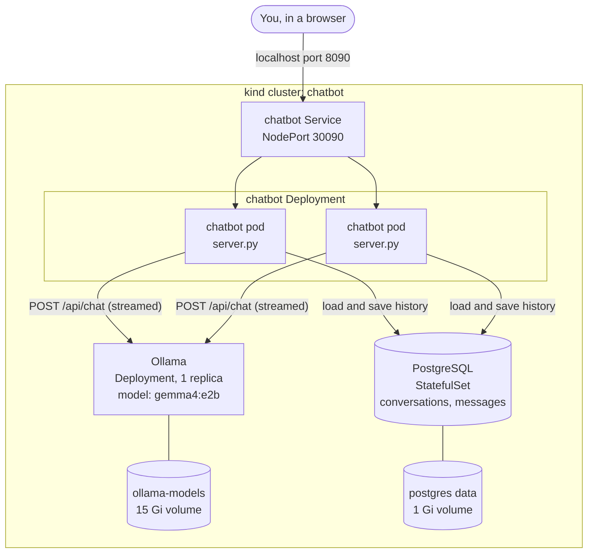
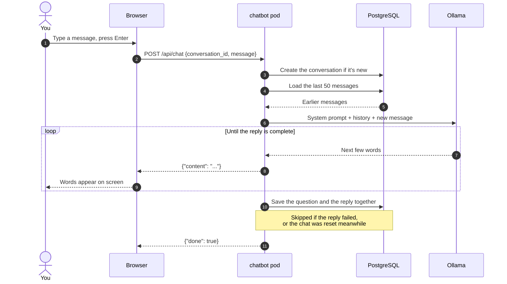
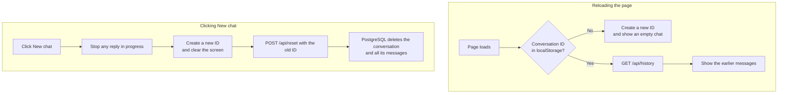

# Architecture

How the chatbot is put together, and what happens when you send a message.

## Components

| Part | What it does |
|---|---|
| **Browser** (`static/index.html`) | Shows the chat. Keeps only a conversation ID (a UUID) in localStorage |
| **chatbot pods** (`server.py`, `db.py`) | Serve the page and the API. They hold no state, so any pod can answer any request |
| **PostgreSQL** | Stores every conversation's messages. Shared by all chatbot pods |
| **Ollama** | Runs the language model and streams its reply. Reachable only inside the cluster |
| **Volumes** | Keep the downloaded model and the stored messages across pod restarts |

## Sending a message

The model doesn't remember anything between requests. "Memory" comes from step 4: the pod loads the earlier messages from PostgreSQL and sends them to the model with every new question.

## Other flows

## Running it without Kubernetes

`make serve` runs the same `server.py` on your Mac at http://localhost:8099. It uses the native Ollama app and a Postgres container on port 5433. `make run` starts the terminal chat (`chat.py`), which talks to Ollama directly and keeps its history in memory, without a database.
