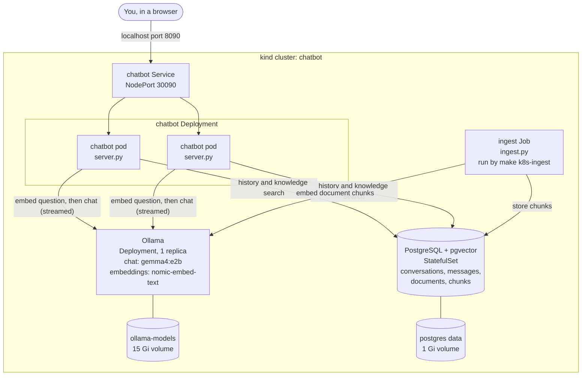
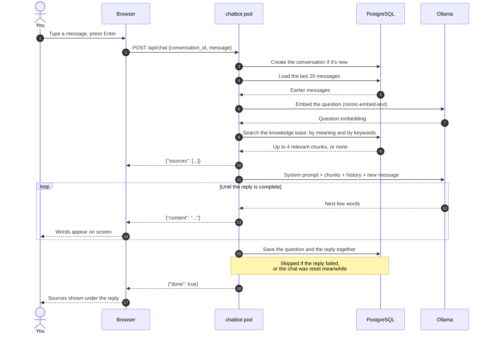
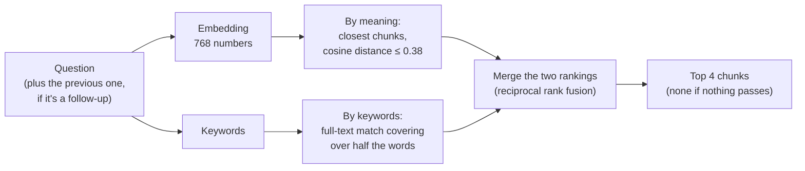
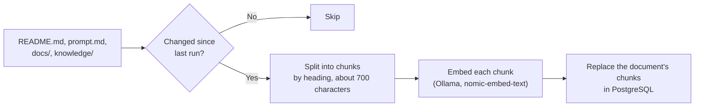
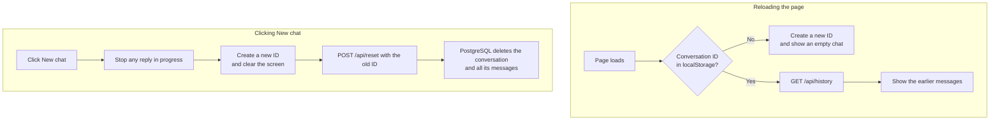

# Architecture

How the chatbot is put together, and what happens when you send a message.

## Components

| Part | What it does |
|---|---|
| **Browser** (`static/index.html`) | Shows the chat and the sources each answer used. Keeps only a conversation ID (a UUID) in localStorage |
| **chatbot pods** (`server.py`, `db.py`, `rag.py`) | Serve the page and the API, and search the knowledge base for each question. They hold no state, so any pod can answer any request |
| **ingest Job** (`ingest.py`) | Splits the project's docs into chunks, embeds them and stores them. Runs on demand, not continuously |
| **PostgreSQL + pgvector** | Stores every conversation's messages, plus the knowledge base: document chunks with their embeddings. Shared by all pods |
| **Ollama** | Runs two models: `gemma4:e2b` writes the replies, and `nomic-embed-text` turns text into embeddings for search. Reachable only inside the cluster |
| **Volumes** | Keep the downloaded models and the database across pod restarts |

## Sending a message

The model doesn't remember anything between requests, and it knows nothing about this project on its own. Two lookups give it both:

- **Memory (steps 4–5):** the pod loads the conversation's earlier messages from PostgreSQL and sends them along with every new question.
- **Knowledge (steps 6–9), which is RAG:** the pod looks up the passages of the project's documentation that match the question, and adds them to the prompt. The model answers from them and names the document it used.

## How the knowledge search works

- **Search by meaning** finds passages that say the same thing in other words.
- **Search by keywords** finds exact names that embeddings handle poorly, like `ollama-models` or `k8s-db`.
- **Both have a cut-off**, so a question unrelated to the docs ("write a poem") gets no excerpts, and the model answers normally.

## Loading the knowledge base

On the cluster, these files are baked into the chatbot image. `make k8s-up` rebuilds the image and then runs the ingest job, so a changed document is picked up on the next deploy. Documents removed from those folders are removed from the knowledge base.

## Other flows

To see all of this in action, follow the [demo walkthrough](demo.md).

## Running it without Kubernetes

`make serve` runs the same `server.py` on your Mac at http://localhost:8099. It uses the native Ollama app and a pgvector Postgres container on port 5433. `make ingest` loads the knowledge base into that container; run `ollama pull nomic-embed-text` once first. `make run` starts the terminal chat (`chat.py`), which talks to Ollama directly and keeps its history in memory, without a database or RAG.
